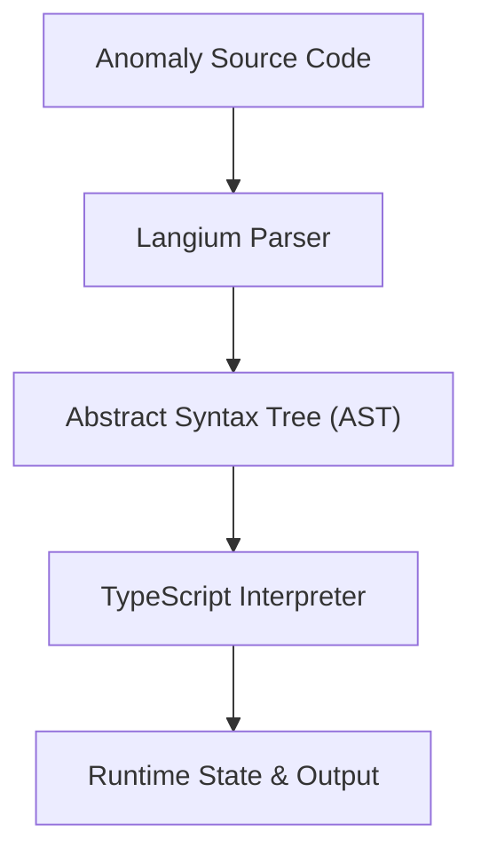
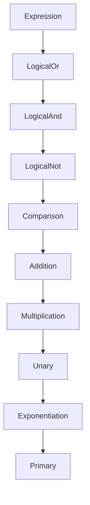

# Anomaly Architecture
<i>Anomaly is still in early development, so the following documentation describes both implemented architecture and planned functionality.  Each has been distinguished as clearly as possible.</i>
## Overview
Anomaly is a data-first language designed to be easy for individuals to use from a non-technical background by reading as close to English as possible, while still retaining as much of the power and functionality of a general-purpose language as possible.  Instead of being focused on databases, like SQL, or general-purpose use, like Python, Anomaly is designed to be a combination of the best parts of both.

## Execution Pipeline


## [Grammar and Parsing](https://github.com/CamBoyd/Anomaly/blob/main/src/language/anomaly.langium)
Anomaly uses standard mathematical operator precedence (PEMDAS).

This is an example of the grammar hierarchy:


The grammar defines separate expression levels to establish operator precedence. Langium uses these rules to construct an AST that preserves the intended grouping of expressions, which the interpreter then evaluates recursively.

This is the operator precedence, highest to lowest.
| Order | Grouping | Operator(s)
|-----------|------------|------------|
| 1 | Parentheses | `(`, `)` |
| 2 | Exponentiation | `^` |
| 3 | Unary operations | Numeric negation (`-`, `+`) |
| 4 | Multiplicative | `*`, `/`, `%` |
| 5 | Additive | `+`, `-` |
| 6 | Comparisons | `>`, `<`, `>=`, `<=`, `==`, `!=` |
| 7 | Logical NOT | `not` |
| 8 | Logical AND | `and` |
| 9 | Logical OR | `or` |

Binary arithmetic operators such as subtraction are left-associative. For example, 10 - 3 - 2 is interpreted as (10 - 3) - 2.

Exponentiation is right-associative, so 2 ^ 3 ^ 2 is interpreted as 2 ^ (3 ^ 2), producing 512.

## [Interpreter Architecture](https://github.com/CamBoyd/Anomaly/blob/main/src/interpreter/anomaly-interpreter.ts)

Anomaly uses a tree-walking interpreter written in TypeScript. Rather than compiling source code into machine code or another programming language, the interpreter operates directly on the Abstract Syntax Tree (AST) generated by Langium.

The interpreter separates **statement execution** from **expression evaluation**.

Statement execution determines what action the program should perform, such as assigning a value to a variable, displaying a result, or evaluating a conditional statement. Expression evaluation determines the values used by those statements, including arithmetic calculations, comparisons, variable references, and Boolean expressions.

Expressions are evaluated recursively. For example, to evaluate `10 + 5 * 2`, the interpreter evaluates the multiplication expression first, then uses its result to evaluate the addition expression. Operator precedence is encoded in the grammar and represented in the resulting AST. The interpreter recursively evaluates this structure without needing to independently determine operator precedence.

The interpreter maintains runtime state using a map of variable names to their corresponding values. Variable assignments update this state, while subsequent expressions can retrieve previously assigned values.

Runtime values are represented using TypeScript types, but the interpreter enforces Anomaly's own evaluation rules. For example, operations requiring numbers explicitly verify their operands are numeric rather than relying on JavaScript's implicit type conversion.

Conditional statements evaluate their conditions and execute the appropriate branch. Logical operators use short-circuit evaluation, avoiding unnecessary evaluation when the result has already been determined.

This architecture keeps parsing and execution separate, allowing the language grammar and interpreter behavior to evolve independently as additional features are introduced.

The interpreter reports invalid operations through runtime errors rather than silently coercing values or continuing execution with unexpected results. This approach supports Anomaly's goal of predictable behavior and provides a foundation for more descriptive, user-friendly diagnostics as the language develops.

## Runtime Type System
The runtime value type is designed to accommodate numbers, Booleans, strings, and dates. Currently, the language grammar and interpreter implement numeric and Boolean literals and operations. Support for strings, dates, and their associated operations is planned.

The data type will be checked at execution time to verify it is a valid expression; avoiding situations like adding a boolean to a number and silently producing an unexpected result.

This behavior is intentional. Because Anomaly is designed for non-technical users, expressions should produce results that align with how those users reasonably interpret the underlying values.  A `true` boolean value will usually be seen by a non-technical user as a word, not `1`.

As additional data types are introduced, the interpreter's type-validation mechanisms will be extended to support their permitted operations.

## Control Flow
Anomaly supports standard conditional statements using if, else if and else statements, with logical "and," "or" and "not," and nesting.

### Operator Precedence
Anomaly's logical expressions follow an explicit precedence hierarchy, with not evaluated before and, and and evaluated before or.

For example:

`1 == 2 or balance > 1000 and not overdueDays > 30`

The expression is grouped according to the language's precedence rules:

`(1 == 2) or ((balance > 1000) and not (overdueDays > 30))`

This produces a predictable interpretation without requiring users to add unnecessary parentheses.

### Short-Circuit Evaluation

The interpreter supports short-circuit evaluation for logical operators.

For logical and, if the left expression evaluates to false, the right expression is not evaluated because the entire condition must be false.

For logical or, if the left expression evaluates to true, the right expression is not evaluated because the entire condition must be true.

This avoids unnecessary computation and prevents evaluation of expressions whose results cannot affect the outcome.

#### Example
```
set balance = 1250
set overdueDays = 45

if 1==2 or balance > 1000 and not overdueDays > 30
    show 1
else if 1==1 or balance < 0
    show 2
else
    if balance > 0
        show balance
    end
end
```
Output: `2`

## Design Decisions
### Accessibility First
Anomaly is designed for individuals who understand their business data but may not have formal programming experience. Its syntax prioritizes readability and familiarity, drawing inspiration from natural language, SQL, and Python.

The intended audience includes financial professionals such as CFOs, controllers, and analysts who need to retrieve, transform, and analyze data without relying on software engineers for every task.

Usability and predictable behavior take priority when architectural tradeoffs arise, while performance remains an important consideration for data-intensive operations.

### Grammar-Driven Parsing

Langium was selected to generate Anomaly's parser and AST types from a formal grammar. This allows development to focus primarily on language semantics, interpreter behavior, and user-facing functionality rather than implementing parsing infrastructure from scratch.

Separating parsing from execution also makes it easier to evolve the language syntax without unnecessarily coupling it to runtime execution logic.

### Predictable Runtime Behavior

Anomaly deliberately avoids implicit type conversions that could produce unexpected results.

For example:

```
set overdue = true
set result = overdue + 10
```

Some programming languages implicitly convert true to the numeric value 1, producing 11.

Anomaly rejects this operation because a Boolean value represents a logical condition, not a number. This behavior is intended to make errors easier to understand and prevent unexpected results.

### Extensibility

The interpreter separates statement execution, expression evaluation, and runtime state management. This modular structure is intended to support additional data types, language constructs, and data-processing capabilities as Anomaly evolves.

Although Anomaly is designed primarily for data manipulation, its architecture is intended to accommodate more advanced programming capabilities without sacrificing the readability of its syntax.

## Planned Extensions

### Data Source Abstraction
Develop a unified interface for accessing data from relational databases, Excel spreadsheets, CSV files, and other structured formats.

### Data Normalization
Represent datasets using consistent internal structures, allowing operations to work independently of the original data source.

### Set-Based Operations
Implement filtering, joining, grouping, aggregation, and transformations across structured datasets.

### Expanded Language Features
Extend the runtime type system and implement additional language constructs while maintaining predictable execution semantics.

### Editor Integration
Provide syntax highlighting, diagnostics, autocompletion, and other language-aware editing features.

### Visual Formula Builder
Develop a visual interface that enables users to construct Anomaly expressions without writing code directly.
